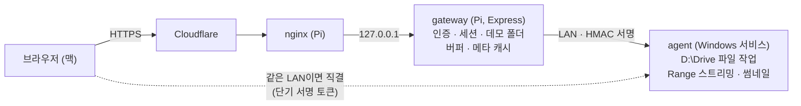

# Wooki Drive

> 맥북 용량이 부족해서 만든 **개인 클라우드 드라이브**.
> 당장 쓰지 않는 파일을 집에 있는 윈도우 데스크탑으로 옮기고, 밖에서도 **Finder를 쓰듯** 웹으로 탐색·미리보기·업로드한다.

NAS나 상용 클라우드를 쓰지 않고 직접 만든 이유는 단순하다. 쓰고 싶은 기능이 분명했고, 그걸 만들면서 생기는 보안·네트워크 문제를 직접 풀어보고 싶었다.

- 도메인: `https://drive.wooki.cloud`
- 상태: **개발 중** (백엔드 기반 완료, 로그인·웹 UI 진행 예정)

---

## 왜 이런 구조인가

| 제약 | 결정 |
|---|---|
| 데스크탑은 평소 꺼져 있고, 인터넷에 직접 노출하고 싶지 않다 | 항상 켜진 **라즈베리 파이를 게이트웨이**로 두고, 데스크탑은 LAN 안에서만 받는다 |
| 파이에 연결할 여분 랜선이 없어 Wake-on-LAN 불가 | 데스크탑이 꺼져 있으면 사용자 선택에 따라 **파이에 임시 보관** → 부팅 시 자동 동기화 |
| 파이는 Wi-Fi라 경유하면 느리다 | 같은 집 네트워크면 **파이를 건너뛰고 데스크탑에 직접 연결** (실패 시 자동 폴백) |
| Cloudflare 무료 플랜은 요청당 100MB 제한 | 업로드는 **32MB 청크 + 이어올리기** |
| 파이 저장소는 SD카드 | 세션·캐시 쓰기를 최소화 (변경 시에만, 디바운스) |

## 아키텍처



- **gateway**는 파일을 저장하지 않고 agent의 스트림을 그대로 흘려보낸다. 브라우저 연결이 끊기면 agent 요청도 즉시 끊는다.
- **agent**는 공유 루트(`D:\Drive`) 밖으로는 절대 나가지 않으며, 서명되지 않은 요청은 전부 거부한다.

## 보안 설계

개인 파일이 걸린 서비스라 기능보다 이 부분에 먼저 시간을 썼다.

**경로 조작 방어** — 모든 경로는 [`packages/shared`](packages/shared)의 단일 함수를 거친다.
- `..`·`.`·빈 세그먼트는 **정규화하지 않고 거부** (조용한 보정은 우회 여지를 만든다)
- 드라이브 문자, UNC, NTFS 대체 데이터 스트림(`a.txt:stream`), 윈도우 예약 이름(`CON`, `nul.txt`, `COM¹`), 후행 점·공백, 깨진 유니코드 거부
- 심볼릭 링크·**정션**을 따라간 실제 위치까지 루트 안인지 확인. 깨진 링크 위에 쓰는 것도 차단
- 맥이 보내는 NFD(자모 분리) 파일명은 새로 만들 때만 NFC로 정규화

**gateway ↔ agent 인증** — HMAC-SHA256 요청 서명
- 방향(audience)을 서명에 포함 → 한쪽 서명을 반대 방향에 재사용 불가
- 타임스탬프 허용 오차 + 일회용 nonce로 재전송 차단. nonce는 서명 검증 **후에만** 기록 (위조 요청으로 저장소를 채울 수 없음)
- 키 회전 지원, 실패 사유는 응답에 싣지 않음

**세션 · 권한**
- 로그인: OAuth(카카오·구글·GitHub) → 오너는 **화이트리스트(provider + 고유 ID) + 패스키 2단계**. 비밀번호는 저장하지 않는다
- 패스키 등록은 **최초 1회 또는 이미 오너인 세션에서만** → OAuth 계정이 털려도 공격자가 자기 패스키를 등록할 수 없다
- OAuth state는 서버 1회용 + 브라우저 쿠키에 묶어 로그인 CSRF 차단, 로그인할 때마다 세션 재발급
- 게스트(포트폴리오 열람자)는 아무 계정으로 로그인해 **데모 폴더와 방명록**만 이용
- `__Host-` 쿠키, 세션 ID는 **해시로만 저장** (세션 파일이 유출돼도 재사용 불가), 권한 상승 시 ID 재발급
- 오너 세션은 **10분 무활동이면 잠기고(Touch ID로만 해제), 2시간이면 완전 만료**. 백그라운드 폴링은 활동으로 치지 않아 탭을 열어 둬도 잠긴다
- 상태 변경 요청은 Origin 검사로 CSRF 차단

**쓰기 작업**
- 영구 삭제·휴지통 비우기는 **패스키로 한 번 더 확인**(2분짜리 1회용 허가) → 세션을 탈취해도 데이터를 지울 수 없다
- 링크·정션을 옮기거나 지울 때는 링크 자체만 다룬다. 영구 삭제는 링크를 절대 따라 들어가지 않는 자체 구현
- 휴지통·업로드 임시 파일은 공유 루트 안 시스템 폴더에 두되, 웹 API로는 보이지도 접근되지도 않는다
- gateway→agent JSON 요청은 본문 해시까지 서명, 업로드 청크는 브라우저가 계산한 SHA-256으로 검증

**미리보기 응답**
- HTML·SVG·JS는 `text/plain`으로 바꿔 보여주고, CSP `sandbox` + `nosniff`로 실행을 원천 차단

## 기능

### v1
- [x] 경로 검증 · 요청 서명 · 단기 토큰 (shared)
- [x] 폴더 목록 · 메타데이터 · 파일 스트리밍 (Range / ETag) (agent)
- [x] 세션 · 역할 검사 · CSRF · agent 프록시 · 데모 폴더 · 데스크탑 상태 (gateway)
- [x] OAuth 3종 + 화이트리스트 + 패스키 (서버)
- [x] Finder 스타일 웹 UI — 목록/아이콘/컬럼 보기, 정렬, 스페이스바 Quick Look, 단축키, 다크 모드
- [x] 청크 업로드 · 이어올리기 · 업로드 큐 (청크별 SHA-256 검증, 폴더 업로드)
- [x] 새 폴더 · 이름 변경 · 끌어서 이동 · 휴지통(되돌리기) · 다중 선택 · 우클릭 메뉴
- [x] 썸네일 — agent가 생성(`sharp`, `ffmpeg`), 파이에 캐시해 데스크탑이 꺼져도 표시
- [x] 폴더 · 여러 항목 zip 다운로드 — 스트리밍(메모리·디스크에 쌓지 않음), ZIP64, UTF-8 이름
- [x] 데스크탑이 꺼져 있어도 마지막 목록·썸네일 탐색, 올린 파일은 파이에 보관했다가 켜지면 자동으로 옮김
- [ ] LAN 직결 (Let's Encrypt DNS-01 인증서)
- [ ] 방명록

### v2 이후
공유 링크, WebDAV 마운트, 검색, 중복 파일 탐지

## 저장소 구조

```
apps/
  web/        Vite + React — 로그인·패스키 화면, Finder 스타일 탐색기
  gateway/    라즈베리 파이에서 실행
  agent/      윈도우 데스크탑에서 실행 (윈도우 서비스)
packages/
  shared/     경로 검증, HMAC 서명, 토큰, 공용 상수 — 브라우저용(.)과 Node 전용(./node) 분리
deploy/       nginx · systemd · 윈도우 서비스 스크립트 (예정)
docs/         설계 문서
```

## 개발

Node.js 22 이상, npm workspaces.

```bash
npm install
npm test          # 전체 테스트 (node:test, 외부 테스트 의존성 없음)
```

실행하려면 각 앱의 `.env.example`을 `.env`로 복사해 값을 채운다. 비밀키는 이렇게 만든다.

```bash
node -e "import('@wooki-drive/shared/node').then(m=>console.log(m.generateSecret()))"
```

```bash
npm run build --workspace apps/web     # 웹 화면 빌드 (gateway 가 서빙)
npm run dev --workspace apps/agent     # 데스크탑
npm run dev --workspace apps/gateway   # 파이
```

로컬에서 OAuth 없이 둘러보려면 gateway `.env`에 `PUBLIC_ORIGIN=http://127.0.0.1:7400`, `COOKIE_SECURE=false`, `DEV_LOGIN=true`를 넣는다. 로그인 화면에 개발용 오너/게스트 버튼이 생긴다. 이 설정은 localhost가 아니면 서버가 시작을 거부한다.

UI만 고칠 때는 `npm run dev --workspace apps/web`(Vite, 5173)로 띄우면 `/api`·`/auth`를 로컬 gateway로 넘긴다.

## 기술 스택

- **Backend**: Node.js 22, Express 5 (ESM, JavaScript)
- **Frontend**: Vite + React 19 (외부 UI 라이브러리 없이 직접 구현)
- **Infra**: Raspberry Pi 5 (Ubuntu), Windows 11, nginx, Cloudflare
- **Test**: `node:test` — 실제 파일 시스템(윈도우 정션 포함)과 agent·gateway를 함께 띄운 통합 테스트
